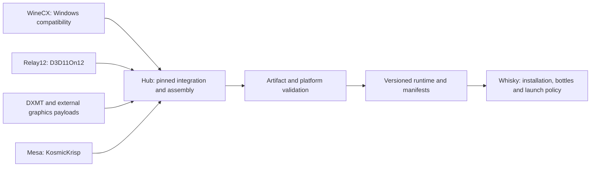

# winecx-gptk: the Wine runtime integration hub

This repository turns independently developed compatibility components into a
reproducible, relocatable Windows runtime for Whisky on Apple Silicon. It pins
the inputs, builds Wine, assembles graphics and media payloads, validates the
combined artifact, and distributes a versioned runtime and consumer catalog.

The purpose is to preserve working games and applications while making component
updates safe to integrate and easy to diagnose. **QA and regression prevention
take priority over new features, faster builds and performance claims.**

## Start here

| Need | Guide |
| --- | --- |
| Understand the system and choose where a fix belongs | [Architecture and ownership](docs/architecture.md) |
| Write, validate, commit and submit a change | [Contributing](CONTRIBUTING.md) |
| Know what each check proves and when a change is ready | [QA and release readiness](docs/qa.md) |
| Work as a coding agent | [AGENTS.md](AGENTS.md) and [SKILLS.md](SKILLS.md) |
| Restore build inputs and iterate locally | [OCI build guide](docs/oci-build-system.md) |
| Follow component updates through to Whisky | [Cross-repository CI](docs/ci-integration.md) |

## How the pieces fit

The hub owns the integration boundary. Windows API fixes belong in WineCX,
D3D11On12 translation in Relay12, Vulkan-to-Metal driver work in Mesa, and
application UI, bottle settings and backend selection in Whisky. The detailed
[ownership map](docs/architecture.md) also covers DXMT, hub-owned GPTK shims and
the experimental ARM64/FEX lane.

The normal runtime contains Wine's x86_64 Unix side and i386/x86_64 Windows
modules, running through Rosetta on Apple Silicon. Graphics routes include
Apple's imported D3DMetal, DXMT, upstream DXVK through the Khronos loader and KosmicKrisp. These paths have different capabilities and
validation requirements; support on one does not prove support on another.

## Sources of truth

| Concern | Source |
| --- | --- |
| Wine, toolchain, graphics and payload revisions | [tools/build/pins.env](tools/build/pins.env) |
| Mesa and Vulkan loader/headers | [runtime/kosmickrisp/pins.env](runtime/kosmickrisp/pins.env) |
| Build and publication job graph | [build.yml](.github/workflows/build.yml) |
| Shared static QA | [qa-common.yml](.github/workflows/qa-common.yml) |
| Saved-artifact validation | [validate.yml](.github/workflows/validate.yml) |
| Paths consumed by Whisky | [runtime-layout.json](contracts/runtime-layout.json) |
| Compatible-client canaries | [runtime-catalog-v2.json](runtime-catalog-v2.json) |
| Legacy-client canaries | [runtime-catalog.json](runtime-catalog.json) |

Use these files for current versions. Older plans and test reports describe the
revisions they tested; they are not release manifests or promises about current
hardware support. The catalog records published artifacts, not an arbitrary
local checkout's build result.

## Development and review

Start on a focused branch, fix the responsible component, add meaningful
regression coverage, and validate the artifact affected by the change. Keep
build orchestration in `tools/`; workflows should connect those reusable steps.
Do not put product runtime logic only in a CI YAML block or edit an ignored
component checkout and assume the hub will publish that edit.

Every change should explain the concrete problem, resulting behavior, ownership
decision, relevant validation and remaining limits. Every agent-created commit
must carry the owner's exact sign-off from [AGENTS.md](AGENTS.md). Follow
[the contribution workflow](CONTRIBUTING.md) and use the
[PR template](.github/pull_request_template.md) to make the result reviewable.

## Further documentation

- [Documentation map](docs/architecture.md#documentation-map): maintained guides
  versus historical evidence.
- [KosmicKrisp deployment](docs/kosmickrisp.md),
  [experimental integration](docs/kosmickrisp-experimental.md),
  [benchmarks](docs/kosmickrisp-benchmarks.md) and
  [bounded game investigation](docs/kosmickrisp-investigation.md).
- [D3D12 interposer testing](docs/DDI-CONCURRENCY-TESTING.md).
- [Native ARM64/FEX research](arm64/README.md).
- [Fork evolution](docs/FORK-CHANGES.md) and
  [recorded OCI CI results](docs/oci-ci-results.md).

See [runtime layout v2](docs/runtime-layout-v2.md) for the coordinated provider migration,
bottle rollback and required physical validation before promotion.
