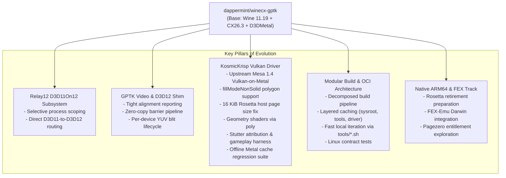

# Architectural Evolution & Changes Since Forking from Dappermint

## 1. Executive Summary & Fork Heritage

`winecx-gptk` was originally forked from [dappermint/winecx-gptk](https://github.com/dappermint/winecx-gptk) to provide a Game Porting Toolkit (GPTK / D3DMetal) compatible Wine runtime for the [Whisky](https://github.com/Whisky-App/Whisky) ecosystem.

While the original upstream initially established the CodeWeavers CrossOver 26.3 patch set rebased across Wine 11.16/11.17 and recently advanced its main line to Wine 11.19, this fork has evolved into a comprehensive, multi-track runtime system. It introduces major architectural enhancements across Direct3D translation, Vulkan drivers, video decoding, native ARM64 execution, and modular CI/build infrastructure.

---

## 2. Runtime Core & Versioning Evolution

Both upstream and this fork have moved the core runtime to **Wine 11.19**, but they manage versioning, delivery channels, and compatibility differently:

* **Upstream Baseline**:
  - Upstream `dappermint/winecx-gptk` bumped `main` to Wine 11.19 (`dad361a`) targeting CrossOver 26.3 and runtime series 4.8.
  - Merged the initial experimental KosmicKrisp Vulkan lane (PRs #12–#17), adding `wine-kosmickrisp`, Rosetta memory budget reporting fixes (`host_page_size()`), and `fillModeNonSolid` polygon support.
  - Carried MoltenVK 1.4.2 and bumped bundled FAudio to 26.10.

* **Fork Advancements (`niltonperimneto/winecx-gptk`)**:
  - Running on the **Wine 11.19** base (`5e79cac`, pinned to `f70ef29` on the `winecx` fork) with active canary releases up through **canary 4.8.9** (`runtime-canary-v4.8.9`).
  - **Dynamic Catalog Stamping ([runtime-catalog.json](file:///Users/niltonperimneto/Projects/winecx-gptk/runtime-catalog.json))**:
    - Expanded capability descriptors including `gptkMajorVersions: [3, 4]`.
    - Network and async IPC capabilities: `wsarecvmsg`, `ipv4ReceiveTOS`, `ipv6ReceiveTrafficClass`, `overlappedReceiveMessage`.
    - Process isolation: `childLaunchPolicies` (schema 1) and `gameModeProcessHost`.
    - Active graphics classifiers: `d3d11`, `dxgi`, `d3d12`, `d3d12core`, `vulkan`, `dxvk`, `dxmt`, `wined3d`, `wow64`.

---

## 3. Relay12 D3D11On12 Subsystem

In stock D3DMetal environments, Direct3D 11 relies entirely on DXVK or DXMT translating to Metal/Vulkan. Apple's native D3D11On12 implementation was missing or stubbed.

* **Relay12 Integration**: Integrated `niltonperimneto/relay12` (pinned to `runtime-a269405`) to forward `D3D11On12CreateDevice` to Relay12's native modules.
* **Process-Specific Scoping**:
  - Uncontrolled D3D11On12 interposition breaks Steam WebHelper (Chromium) and launcher overlays.
  - Implemented selective routing controlled by environment variables:
    - `RELAY12_EXPERIMENTAL_FRAME=1`: Master activation switch.
    - `RELAY12_EXPERIMENTAL_FRAME_APPS`: Whitelist of game binaries.
    - `RELAY12_EXPERIMENTAL_FRAME_SKIP`: Explicit blacklist for launchers (e.g. `steamwebhelper.exe`).
* **Verification Fixtures**: Added [tests/d3d11_on12stub_mock.c](file:///Users/niltonperimneto/Projects/winecx-gptk/tests/d3d11_on12stub_mock.c) and [tests/d3d11on12core_mock.c](file:///Users/niltonperimneto/Projects/winecx-gptk/tests/d3d11on12core_mock.c) validating that interposition routes accurately across whitelisted, foreign, and launcher processes.

---

## 4. GPTK Video Interposer & D3D12 Shim Robustness

Games utilizing D3D12 video decoding (Media Foundation / Direct3D 12 video processors) previously suffered from pipeline stalls, memory leaks, and texture corruption during in-game cutscenes:

* **Tight Alignment Reporting**: Fixed D3D12 resource allocation alignment reporting in [gptk-video/d3d12shim.c](file:///Users/niltonperimneto/Projects/winecx-gptk/gptk-video/d3d12shim.c), preventing Apple D3DMetal crashes on strict resource boundaries.
* **Zero-Copy Barrier Optimization**: Restored the high-performance zero-copy barrier pass-through path once video playback finishes. Barrier arrays exceeding 32 elements are now preserved and forwarded intact without unnecessary heap reallocations.
* **Per-Device YUV Blit Lifecycle**: Refactored [gptk-video/yuvblit.h](file:///Users/niltonperimneto/Projects/winecx-gptk/gptk-video/yuvblit.h) so pipeline state objects (PSOs) and color conversion resources are tracked per `ID3D12Device`, preventing cross-device resource leaks when video playback devices are destroyed and recreated.
* **Recording Test Interposer**: Created [tests/d3d12shim.c](file:///Users/niltonperimneto/Projects/winecx-gptk/tests/d3d12shim.c) and [tests/d3d12shim_mock.c](file:///Users/niltonperimneto/Projects/winecx-gptk/tests/d3d12shim_mock.c) to inspect and verify every command forwarded to D3DMetal in headless CI.

---

## 5. KosmicKrisp (Mesa Vulkan-on-Metal) & Investigation Stack

While upstream merged the foundational KosmicKrisp driver bundle and probe gates, this fork developed the complete end-to-end investigation, packaging, and validation stack:

* **Driver & Loader Packaging**:
  - Cross-compiles an `x86_64` slice of Mesa (`libvulkan_kosmickrisp.dylib`), Khronos Vulkan Loader (`libvulkan.1.dylib`), and relocatable ICD manifests.
  - Dedicated launchers ([wine-kosmickrisp](file:///Users/niltonperimneto/Projects/winecx-gptk/runtime/kosmickrisp/wine-kosmickrisp), [wine-kosmickrisp-dxvk](file:///Users/niltonperimneto/Projects/winecx-gptk/runtime/kosmickrisp/wine-kosmickrisp-dxvk)) utilizing `WINE_VULKAN_LIBRARY` and `VK_DRIVER_FILES`.
* **Rosetta 4 KiB vs. 16 KiB Memory Budget Fix**:
  - Corrected `PAGE_SIZE` assumption under Rosetta (`host_page_size()`), resolving 75% VRAM reporting deficit to `VK_EXT_memory_budget`.
* **fillModeNonSolid Polygon Mode Support**:
  - Implemented mapping of `VkPolygonMode` to Metal's `setTriangleFillMode:`, enabling stock DXVK 3.1.1 to initialize D3D9 and D3D11 (FL 11_1) devices.
* **Reproducible DXVK 3.x Packaging ([scripts/package-dxvk.sh](file:///Users/niltonperimneto/Projects/winecx-gptk/scripts/package-dxvk.sh))**:
  - Bundles pinned upstream DXVK 3.1.1 (x32 and x64) under `Libraries/DXVK3` with digest validation and licenses, eliminating dynamic downloads during test steps.
* **Gameplay Automation & Window Capture Harness**:
  - Native Swift helper ([runtime/kosmickrisp/gameplay_ui.swift](file:///Users/niltonperimneto/Projects/winecx-gptk/runtime/kosmickrisp/gameplay_ui.swift)) utilizing CoreGraphics and Accessibility APIs for window detection, bounds tracking, and input automation with `-warnings-as-errors` and SHA-256 binary caching.
  - Process supervisor ([runtime/kosmickrisp/gameplay.py](file:///Users/niltonperimneto/Projects/winecx-gptk/runtime/kosmickrisp/gameplay.py)) tracking window focus and startup deadlines.
* **Stutter Attribution & Host Telemetry**:
  - Analyzer ([runtime/kosmickrisp/stutter.py](file:///Users/niltonperimneto/Projects/winecx-gptk/runtime/kosmickrisp/stutter.py)) correlating monotonic frame jitter against `MESA_KK_PRESENT_LOG` and `MESA_KK_COMPILE_LOG` without double-counting parallel threads.
  - Host diagnostic streamer ([runtime/kosmickrisp/investigation_host.py](file:///Users/niltonperimneto/Projects/winecx-gptk/runtime/kosmickrisp/investigation_host.py)) capturing GPU restarts, kernel panics, and OOM kills via macOS `os_log`.
  - Comparative offline reporter ([runtime/kosmickrisp/investigation_report.py](file:///Users/niltonperimneto/Projects/winecx-gptk/runtime/kosmickrisp/investigation_report.py)) for paired cold vs. warm cache runs.
* **Transactional Campaign Coordinator**:
  - Top-level coordinator ([runtime/kosmickrisp/investigate.py](file:///Users/niltonperimneto/Projects/winecx-gptk/runtime/kosmickrisp/investigate.py)) with exclusive bottle locking, timeout protection, and journaled rollback for saves, user configs, and DXVK DLLs.
* **Standalone Metal Cache Regression Suite**:
  - Standalone harness ([tests/kosmickrisp_metal_cache.c](file:///Users/niltonperimneto/Projects/winecx-gptk/tests/kosmickrisp_metal_cache.c), [tests/run_kosmickrisp_metal_cache.py](file:///Users/niltonperimneto/Projects/winecx-gptk/tests/run_kosmickrisp_metal_cache.py)) exercising 31 cache operational scenarios against Mesa source in isolation.
* **Physical GPU CI Validation**:
  - Updated [.github/workflows/build.yml](file:///Users/niltonperimneto/Projects/winecx-gptk/.github/workflows/build.yml) so hosted virtual runners skip the hardware probe (`vkEnumeratePhysicalDevices: -3`) and delegate hardware verification to an owner-dispatched physical GPU runner (`gpu-validation`).

---

## 6. Build System Overhaul & OCI Layer Architecture

The original build workflow was a monolithic script that rebuilt all dependencies from scratch on every run (45–90+ minutes). The overhauled architecture decomposes the system into modular lifecycle tiers:

* **Modular Shell Scripts ([tools/](file:///Users/niltonperimneto/Projects/winecx-gptk/tools/))**:
  - Extracted inline CI scripts into standalone tools:
    - [tools/setup_sysroot.sh](file:///Users/niltonperimneto/Projects/winecx-gptk/tools/setup_sysroot.sh): Prepares pinned Nixpkgs x86_64 host libraries.
    - [tools/setup_mingw.sh](file:///Users/niltonperimneto/Projects/winecx-gptk/tools/setup_mingw.sh): Pinned `llvm-mingw` UCRT cross-compiler.
    - [tools/build_wine_tools.sh](file:///Users/niltonperimneto/Projects/winecx-gptk/tools/build_wine_tools.sh): Builds native `__tooldeps__` (`wmc`, `wrc`, `widl`).
    - [tools/configure_wine.sh](file:///Users/niltonperimneto/Projects/winecx-gptk/tools/configure_wine.sh) & [tools/make_wine.sh](file:///Users/niltonperimneto/Projects/winecx-gptk/tools/make_wine.sh): Compiles Wine PE and Unix binaries.
    - [tools/assemble_runtime.sh](file:///Users/niltonperimneto/Projects/winecx-gptk/tools/assemble_runtime.sh) & [tools/package_runtime.sh](file:///Users/niltonperimneto/Projects/winecx-gptk/tools/package_runtime.sh): Ingests payloads, rewrites `@loader_path`, and codesigns.
    - [tools/run_probes.sh](file:///Users/niltonperimneto/Projects/winecx-gptk/tools/run_probes.sh): Unified execution of relocatability, windowing, and D3D/Vulkan feature probes.
* **OCI Layer Caching ([tools/build/oci.sh](file:///Users/niltonperimneto/Projects/winecx-gptk/tools/build/oci.sh))**:
  - Implemented OCI container/registry layer caching for `sysroot`, `tools`, `payloads`, and `driver`.
  - Re-uses immutable binary archives when pins do not change, dropping active development build cycles down to **3–5 minutes**.
* **Specialized CI Workflows**:
  - [.github/workflows/kosmickrisp.yml](file:///Users/niltonperimneto/Projects/winecx-gptk/.github/workflows/kosmickrisp.yml): Dedicated Mesa/driver build pipeline.
  - [.github/workflows/validate.yml](file:///Users/niltonperimneto/Projects/winecx-gptk/.github/workflows/validate.yml): Reusable verification matrix.
  - [.github/workflows/oci-ci-test.yml](file:///Users/niltonperimneto/Projects/winecx-gptk/.github/workflows/oci-ci-test.yml): Fast Linux contract tests for build scripts.

---

## 7. Native ARM64 Host & FEX Exploration Lane

Anticipating Apple's eventual retirement of Rosetta 2 in future macOS versions, an exploratory native ARM64 lane was established in [arm64/](file:///Users/niltonperimneto/Projects/winecx-gptk/arm64/):

* **Native ARM64 Wine Compilation**: Recipes in [arm64/build-arm64-unix.sh](file:///Users/niltonperimneto/Projects/winecx-gptk/arm64/build-arm64-unix.sh) to build Wine's Unix half natively for `arm64-apple-darwin`.
* **FEX-Emu Integration**:
  - Scripts ([arm64/build-fex-arm64.sh](file:///Users/niltonperimneto/Projects/winecx-gptk/arm64/build-fex-arm64.sh), [arm64/install-fex.sh](file:///Users/niltonperimneto/Projects/winecx-gptk/arm64/install-fex.sh)) compiling FEX with macOS patches ([arm64/fex/patches/](file:///Users/niltonperimneto/Projects/winecx-gptk/arm64/fex/patches/)).
  - Smoke tests ([tests/fex_unixlib_smoke.c](file:///Users/niltonperimneto/Projects/winecx-gptk/tests/fex_unixlib_smoke.c), [tests/x86_smoke.c](file:///Users/niltonperimneto/Projects/winecx-gptk/tests/x86_smoke.c)).
* **Pagezero & Address Space Research**:
  - Developed [tests/pagezero_probe.c](file:///Users/niltonperimneto/Projects/winecx-gptk/tests/pagezero_probe.c) to document the architectural requirement for the `com.apple.developer.cross-architecture-support` entitlement to map the low 4GB of virtual address space on Apple Silicon.
* **Wine.app Bundle Packaging**: [arm64/make-wine-app.sh](file:///Users/niltonperimneto/Projects/winecx-gptk/arm64/make-wine-app.sh) for bundling and signing under developer provisioning profiles.

---

## 8. Comprehensive Feature Comparison Table

| Capability / Subsystem | Upstream (`dappermint/winecx-gptk`) | Current Fork (`niltonperimneto/winecx-gptk`) |
| :--- | :--- | :--- |
| **Wine / CrossOver Base** | Wine 11.19 / CrossOver 26.3 (`dad361a`, Series 4.8) | Wine 11.19 / CrossOver 26.3 (`5e79cac`, Canary 4.8.9) |
| **Release / Distribution Channel** | Source releases / Manual CI tag builds | Automated canary track (`runtime-canary-v4.8.9`) + `runtime-catalog.json` |
| **D3D11On12 Support** | Missing / Stubs only | Integrated Relay12 (`runtime-a269405`) with process-selective routing |
| **D3D12 Video Playback** | Basic interposer | Tight alignment, zero-copy barriers, per-device YUV PSOs |
| **Vulkan Implementations** | Dual stack: MoltenVK 1.4.2 + KosmicKrisp experimental | Dual stack: MoltenVK baseline + KosmicKrisp experimental + Physical GPU CI |
| **DXVK Packaging** | Dynamic download during CI probe | Bundled pinned DXVK 3.1.1 under `Libraries/DXVK3` with digest validation |
| **Rosetta Memory Budget** | `host_page_size()` 16 KiB fix merged (PR #17) | `host_page_size()` 16 KiB fix + automated verification |
| **fillModeNonSolid Polygon Support** | Merged (PR #13) | Merged + comprehensive D3D9/D3D11 FL 11_1 tests |
| **Investigation & Stutter Tooling** | None (PRs #19, #21–#23 pending) | Full stack: stutter attribution, window harness, `os_log` telemetry, coordinator |
| **Metal Cache Regression Testing** | None (PR #18 pending) | Standalone C/Python harness covering 31 cache scenarios |
| **Build Architecture** | Monolithic `build.yml` with dual runner support | Tiered OCI-layer caching + modular `tools/*.sh` + Linux contract tests |
| **Clean Build Turnaround** | ~45–60 minutes | 3–5 minutes (cached layers) / ~15 minutes (clean) |
| **ARM64 / FEX Exploration** | Basic arm64 runtime recipe in tree | Fully scripted ARM64 build, FEX integration, and pagezero probes |
| **Automated Testing** | Relocatability & smoke gates | 135+ unit & contract tests, DDI concurrency fixtures, offline cache tests |

---

## 9. Consolidated Documentation Directory Map

* **Architecture & Build System**:
  - [docs/build-system-plan.md](file:///Users/niltonperimneto/Projects/winecx-gptk/docs/build-system-plan.md): 4-cycle build overhaul specification.
  - [docs/oci-build-system.md](file:///Users/niltonperimneto/Projects/winecx-gptk/docs/oci-build-system.md): OCI container layer caching guide.
  - [docs/oci-ci-results.md](file:///Users/niltonperimneto/Projects/winecx-gptk/docs/oci-ci-results.md): CI execution benchmarks and layer measurements.
  - [docs/HUB-ARCHITECTURE.md](file:///Users/niltonperimneto/Projects/winecx-gptk/docs/HUB-ARCHITECTURE.md): Integration hub, component pinning, and QA architecture.
* **KosmicKrisp & Vulkan**:
  - [docs/kosmickrisp-plan.md](file:///Users/niltonperimneto/Projects/winecx-gptk/docs/kosmickrisp-plan.md): Long-term migration gates and feasibility roadmap.
  - [docs/kosmickrisp-experimental.md](file:///Users/niltonperimneto/Projects/winecx-gptk/docs/kosmickrisp-experimental.md): Architecture of the experimental Vulkan runtime.
  - [docs/kosmickrisp-performance.md](file:///Users/niltonperimneto/Projects/winecx-gptk/docs/kosmickrisp-performance.md): Rosetta performance analysis and memory budget fix.
  - [docs/kosmickrisp-test-results.md](file:///Users/niltonperimneto/Projects/winecx-gptk/docs/kosmickrisp-test-results.md): Measured test results and Hades benchmark logs.
  - [docs/kosmickrisp.md](file:///Users/niltonperimneto/Projects/winecx-gptk/docs/kosmickrisp.md): Rosetta fallback deployment guide and GPU validation.
  - [docs/kosmickrisp-investigation.md](file:///Users/niltonperimneto/Projects/winecx-gptk/docs/kosmickrisp-investigation.md): Multi-case investigation campaign manual.
  - [docs/kosmickrisp-metal-cache-tests.md](file:///Users/niltonperimneto/Projects/winecx-gptk/docs/kosmickrisp-metal-cache-tests.md): 31-scenario Metal pipeline cache test index.
  - [docs/kosmickrisp-dxvk-local.md](file:///Users/niltonperimneto/Projects/winecx-gptk/docs/kosmickrisp-dxvk-local.md) & [docs/kosmickrisp-fillmode-port.md](file:///Users/niltonperimneto/Projects/winecx-gptk/docs/kosmickrisp-fillmode-port.md): Technical notes on DXVK 3.x and polygon mode porting.
* **Direct3D & Relay12**:
  - [docs/DDI-CONCURRENCY-TESTING.md](file:///Users/niltonperimneto/Projects/winecx-gptk/docs/DDI-CONCURRENCY-TESTING.md): Concurrency contracts and memory padding tests for DDI.
* **Native ARM64 & FEX**:
  - [arm64/README.md](file:///Users/niltonperimneto/Projects/winecx-gptk/arm64/README.md): Native ARM64 Wine and FEX execution manual.
