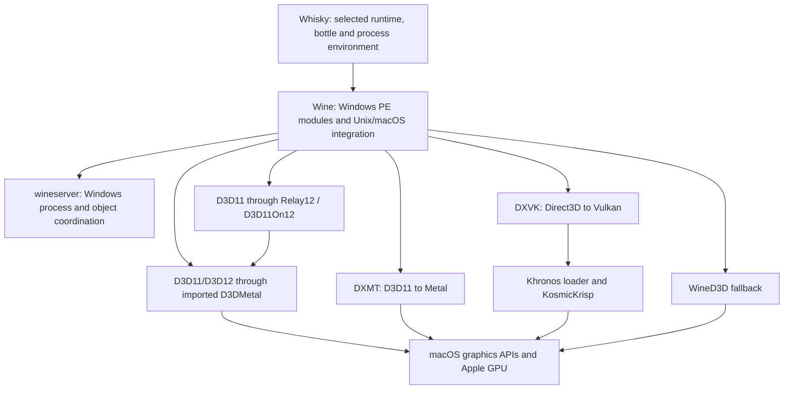
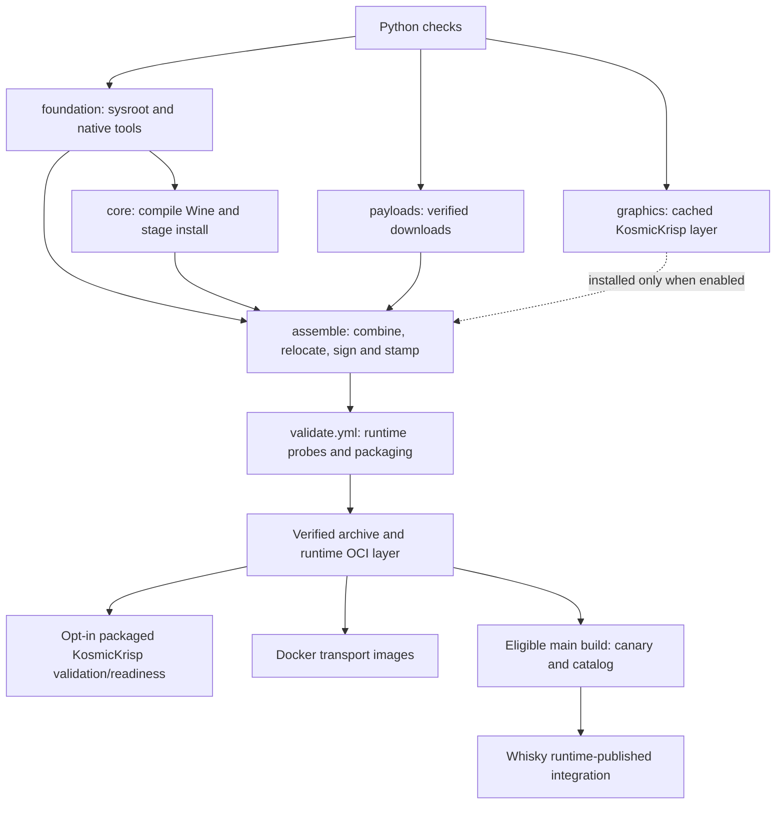

# Architecture and ownership

winecx-gptk is the integration and distribution hub for the Wine runtime used
by Whisky. Its output must work outside the builder, preserve the consumer
contract, and combine components that have each passed their own checks.
Component CI is necessary; hub integration QA must still verify the combination.

## Repository boundaries

| Repository or component | Owns | What the hub consumes |
| --- | --- | --- |
| `niltonperimneto/winecx` | Windows API behavior, ntdll, wineserver, win32u/winemac, Wine media and loader integration | An immutable Wine source commit |
| `niltonperimneto/relay12` | D3D11On12 translation, COM/DDI behavior, synchronization and resource translation | A source-identified release archive and checksum |
| `niltonperimneto/mesa` | KosmicKrisp Vulkan-to-Metal behavior, NIR/Poly shader lowering and driver caches | A pinned Mesa tree built through the KosmicKrisp recipe |
| `niltonperimneto/dxmt` | Direct D3D11-to-Metal translation | A pinned release artifact tied to a source commit |
| External DXVK and Khronos components | Their translators, Vulkan loader and headers | The exact source/archive versions and integrity data in the pins and fetch recipes |
| This repository | Build recipes, integration adapters, payload layout, checks, packaging, OCI transport and release metadata | The assembled runtime |
| `niltonperimneto/Whisky` | macOS UI, bottle configuration, runtime selection, launcher policy, installation and consumer validation | The catalog, runtime archive and manifests |

A feature can span repositories. Land and test the component behavior first,
then move the hub pin with integration evidence, then update the consumer if its
contract changes. Read each repository's own agent instructions before editing
it. A request to work in the hub does not automatically authorize unrelated
changes or publication elsewhere.

### Choose the location from the cause

- A Windows API or Wine process/thread defect belongs in WineCX, with its
  regression coverage. The hub should select the fixed commit.
- A Vulkan capability, shader translation or Metal resource defect belongs in
  Mesa. Do not advertise a feature in packaging to conceal a missing driver
  implementation.
- A D3D11On12 translation defect belongs in Relay12; a DXMT implementation defect
  belongs in DXMT. Changing the selected backend can be a documented workaround,
  but does not repair the original implementation.
- A missing packaged library, broken loader symlink, incorrect checksum or stale
  layer key belongs here. A bottle picker or per-application launch decision
  belongs in Whisky.
- Hub-specific D3D12 video and DXGI interposers live in `gptk-video/`. Keep their
  scope explicit; do not duplicate a component's general renderer here.

The optional patch application in `tools/prepare_source.sh` supports integration
patches, but a patch needs a stated owner, pinned base, tests and removal or
upstreaming plan. Avoid accumulating a second untracked Wine fork in build
scripts. An edit under the ignored `winecx/` checkout is only a local experiment
until the source pin or an explicit reviewed patch reproduces it.

## Execution architecture

The normal lane builds x86_64 Darwin binaries and both i386 and x86_64 Windows
modules. Rosetta runs the x86_64 host side on Apple Silicon; WoW64 enables the
32-bit Windows side. Native build tools and the Windows PE compiler are separate
inputs. Preserve the configured toolchain and ABI rather than substituting a
compiler based only on its executable name.

CrossOver-derived Wine is part of the GPTK integration contract: Windows exports,
loader behavior and the Wine Unix-call interfaces used by D3DMetal must remain
compatible. A successful Wine rebase or `wine64 --version` does not prove that
the imported Apple payload can still initialize and render. Validate the affected
interface through the complete graphics path.

`DXVK3/` carries upstream DXVK for both Windows architectures. New layouts
require KosmicKrisp as their sole bundled Vulkan provider; `DXVK/` is reserved
for reading old runtimes during migration. See [layout v2](runtime-layout-v2.md).
Apple's D3DMetal
payload is supplied through the application's GPTK import/deployment path; the
hub preserves the required interfaces and stages its own video interposer.

Wine's media components use bundled decoding dependencies and addons. FFmpeg,
GStreamer, their dynamically loaded plugins, Mono and Gecko are part of the
integration surface, not optional files to drop solely to reduce archive size.

`arm64/` and the associated FEX tools are a separate research lane. Passing an
ARM64 build or probe does not establish compatibility of the Rosetta runtime,
and experimental ARM64 payloads must not replace a live bottle's x86 payloads.

## Build and artifact flow

The graph describes data flow. Exact `needs`, conditions, credentials and
publication guards live in [build.yml](../.github/workflows/build.yml). In the
current main workflow, the graphics layer is built/restored independently even
when installation of KosmicKrisp into the assembled runtime is disabled.

| Layer or stage | Implementation | Boundary |
| --- | --- | --- |
| Environment/bootstrap | `tools/build/common.sh`, `tools/bootstrap_build.sh` | Pinned inputs and local/Actions environment |
| Foundation | `tools/setup_mingw.sh`, `tools/setup_sysroot.sh` | PE toolchain, Darwin dependencies and exported Nix closure |
| Native tools | `tools/build_wine_tools.sh` | Tools required to build the pinned Wine tree |
| Wine core | `tools/prepare_source.sh`, `tools/configure_wine.sh`, `tools/make_wine.sh`, `tools/build_wine_core.sh` | Reproducible source preparation, compilation and staged install |
| Payloads | `tools/fetch_payloads.sh` | Verified graphics and addon downloads |
| Driver | `tools/build_kosmickrisp.sh`, `runtime/kosmickrisp/` | Mesa snapshot, loader, headers and driver-specific helpers |
| Assembly | `tools/assemble_runtime.sh`, `tools/install_kosmickrisp.sh` | Consumer layout, dependency closure, loader paths, signatures and optional driver integration |
| Validation/package | `tools/run_probes.sh`, `tools/check_runtime_layout.py`, `tools/package_runtime.sh` | Tested and described `Libraries/` archive |
| OCI transport | `tools/build/oci.sh`, `tools/build/archive.py`, `tools/import_layer.sh`, `docker/` | Digest-addressed exchange between build jobs and local workspaces |

Keep reusable behavior in these scripts and helpers. Workflow YAML connects
jobs and passes references; avoid implementing a second build system inside it.
Darwin compilation, signing and macOS probes run on macOS. Linux Docker images
transport the component artifacts; they are not runnable macOS containers.

### Caches and reproducibility

[cache_key.py](../tools/build/cache_key.py) hashes the component's inputs,
recipes and relevant host toolchain. It separates Wine, payload and driver
changes so unrelated work can be reused. Mono/Gecko metadata read from Wine's
`addons.c` also affects payload keys. ccache is a separate compiler-object cache.

ORAS packages carry a component archive and metadata. Consumers use manifest
digest references and verify envelope checksums and extraction paths. Missing
cache entries allow rebuilding; integrity, authentication and transport errors
must not be disguised as cache misses. A restored layer is not a substitute for
validating the newly assembled combination.

See [the OCI guide](oci-build-system.md) for setup, local commands and retrying
saved assemblies, and [cross-repository CI](ci-integration.md) for dispatches.

## Consumer and release contracts

- `contracts/runtime-layout.json` defines paths Whisky relies on, including a
  separate KosmicKrisp set. The checker verifies presence; it does not by itself
  prove architecture, executable validity or runtime behavior.
- `WhiskyWineVersion.plist` describes the assembled runtime's version and
  advertised capabilities. Capability changes need matching implementation and
  evidence, not just a metadata edit.
- `RuntimeManifest.json` inventories regular payload files with sizes and
  SHA-256 hashes; the packaging script excludes the metadata envelope itself and
  symlinks from that inventory. Loader links still need independent validation.
- `Libraries.tar.gz.sha256` identifies the distributed archive.
  `RuntimeNetworkVerification.txt` retains the network probe result.
- `runtime-catalog.json` advertises the published canary archive, digest, minimum
  OS and capabilities. It is updated by publication; do not hand-edit it to
  advertise an unbuilt local tree.

Changes to a path or schema need a coordinated producer/consumer migration,
backward compatibility where required, and a rollback plan. A local fast build,
experimental GPU result or OCI upload is not a release approval. Repository
permissions and protected-branch settings are additional external controls;
documentation does not configure them.

## Documentation map

The [README](../README.md), this architecture guide,
[CONTRIBUTING.md](../CONTRIBUTING.md), [QA guide](qa.md),
[AGENTS.md](../AGENTS.md), [SKILLS.md](../SKILLS.md),
[OCI guide](oci-build-system.md) and [CI integration guide](ci-integration.md)
describe maintained workflows. Update them when changing the corresponding
interface or process.

Plans, dated validation reports, fork history and performance investigations in
`docs/` preserve context and revision-specific evidence. Keep their provenance;
link newer results instead of presenting an old experiment as the current
release's behavior. Large logs, screenshots and game data belong in ignored
local output or retained CI artifacts, with a concise evidence index in docs.
